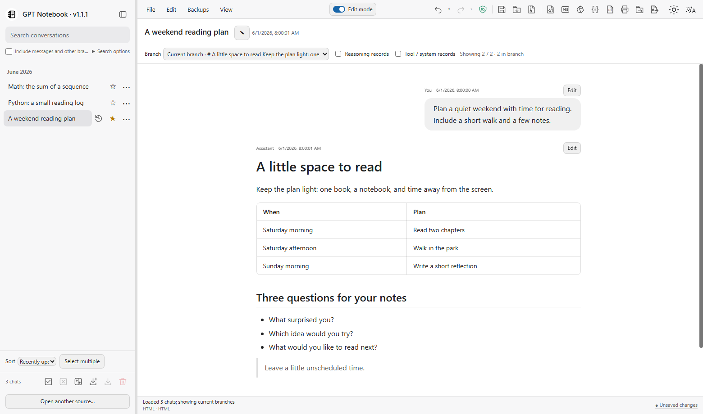
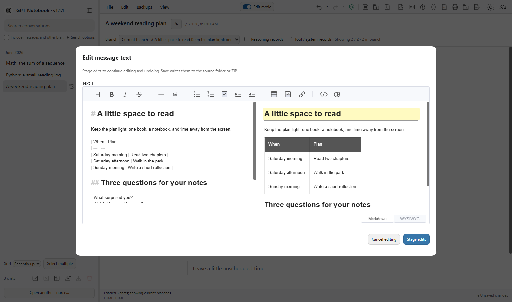
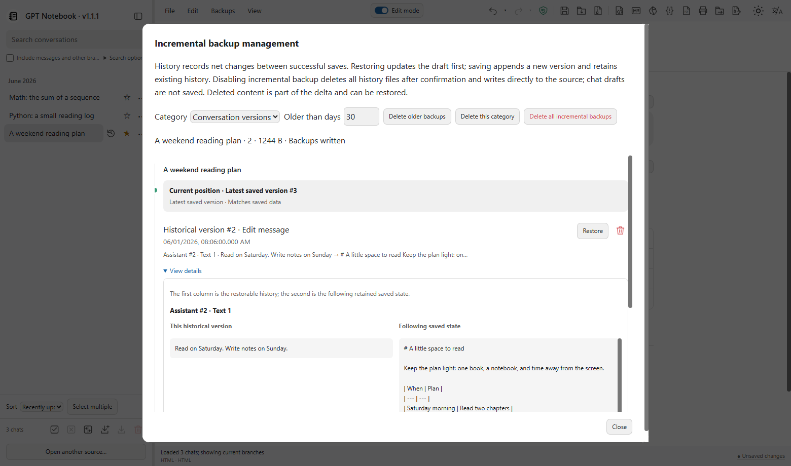
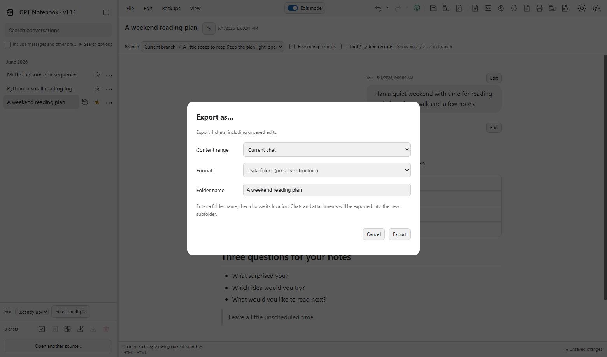

<div align="center">


# GPT Notebook

**Read, edit and export your ChatGPT conversations — locally, in one HTML file.**

[](./LICENSE)
[](https://github.com/chchaoo/gpt-notebook/releases/latest)
[](https://github.com/chchaoo/gpt-notebook/releases/latest)

**[Download HTML](https://github.com/chchaoo/gpt-notebook/releases/latest)** · **[Try the web demo](https://chchaoo.github.io/gpt-notebook/)** · **[简体中文](README.zh-CN.md)**

[User manual](https://github.com/chchaoo/gpt-notebook/wiki/English-Manual) · [Build from source](https://github.com/chchaoo/gpt-notebook/wiki/Build-from-Source)

</div>

## What you can do

| Feature | What it does | Guide |
| --- | --- | --- |
| **Markdown & HTML** | Export standalone HTML or Markdown with media. | [Export formats](https://github.com/chchaoo/gpt-notebook/wiki/Read-Edit-Export#export-what-you-need) |
| **PDF / Print** | Print selected chats or save them as PDF through the browser. | [PDF and print](https://github.com/chchaoo/gpt-notebook/wiki/Read-Edit-Export#pdf-and-print) |
| **Obsidian vault** | Export linked Markdown notes, formulas, an index and local attachments. | [Export to Obsidian](https://github.com/chchaoo/gpt-notebook/wiki/Export-to-Obsidian) |
| **Split & merge** | Split selected chats into smaller archives or import chats into another archive. | [Split and merge archives](https://github.com/chchaoo/gpt-notebook/wiki/Split-and-Merge-Archives) |
| **Read & search** | Open folders or ZIPs, search messages and switch branches. | [Reading and search](https://github.com/chchaoo/gpt-notebook/wiki/Read-Edit-Export#read-and-find) |
| **Edit & organize** | Turn on Edit mode to edit text, star chats, reorder and undo changes. | [Editing and stars](https://github.com/chchaoo/gpt-notebook/wiki/Read-Edit-Export#edit-a-draft) |
| **Save & restore** | Save changes to an archive, compare versions and restore incremental history. | [Saving and history](https://github.com/chchaoo/gpt-notebook/wiki/Saving-and-History) |
| **JSON & source-data copies** | Export original-structure JSON, a data folder or ZIP with relevant attachments. | [Export formats](https://github.com/chchaoo/gpt-notebook/wiki/Read-Edit-Export#export-what-you-need) |

Folder exports support a custom subfolder name, and exports show preparation and write progress. [Export guide](https://github.com/chchaoo/gpt-notebook/wiki/Read-Edit-Export#name-a-folder-export).

**Need a ChatGPT export first?** Open **Settings → Data controls → Export data** in ChatGPT. [Follow the illustrated export guide](https://github.com/chchaoo/gpt-notebook/wiki/Export-from-ChatGPT).


<div align="center">



*Actual application screenshot. All conversations shown are fictional [samples](examples/en/sample-archive.zip).*

</div>

## A closer look

### Edit with a live preview

<div align="center">



</div>

Stage an edit, then save when ready. [Editing guide](https://github.com/chchaoo/gpt-notebook/wiki/Read-Edit-Export).

### Compare saved versions

<div align="center">



</div>

Inspect changes before restoring a version to your draft. [Saving and history](https://github.com/chchaoo/gpt-notebook/wiki/Saving-and-History).

<details>
<summary>Export options</summary>

<div align="center">



</div>

Choose the range and format; exports include your current draft. [Export guide](https://github.com/chchaoo/gpt-notebook/wiki/Read-Edit-Export#export-what-you-need).

</details>

## Get started

1. Download **gpt-notebook.html** and open it in a recent desktop Chrome or Edge.
2. [Request a ChatGPT export](https://github.com/chchaoo/gpt-notebook/wiki/Export-from-ChatGPT) if you do not have one, then open the ZIP or the extracted folder.
3. Select a conversation. Read, edit a draft, save, or export what you need.

No installation, server, account or API key. Try the [sample ZIP](examples/en/sample-archive.zip) first. [Step-by-step guide](https://github.com/chchaoo/gpt-notebook/wiki/Get-Started).

## Build

Python 3.12+ builds the blank HTML using committed runtime assets:

```sh
python tools/project.py verify
python tools/project.py build
```

Tests additionally use Node.js 24 and pnpm 11.25.0. [Complete build instructions and repository map](https://github.com/chchaoo/gpt-notebook/wiki/Build-from-Source).

## Privacy and scope

Archives are processed locally. The application does not upload chats or generate new AI replies. Exports containing your chats remain private files; a clicked external source link can open its website. Save modifies the selected source when supported, so start with a copy. [FAQ](https://github.com/chchaoo/gpt-notebook/wiki/FAQ).

## License

[MIT](LICENSE). Incorporated code and runtime component notices are retained in [NOTICE](NOTICE.md) and [third-party notices](THIRD_PARTY_NOTICES.md). This project is not affiliated with OpenAI.
