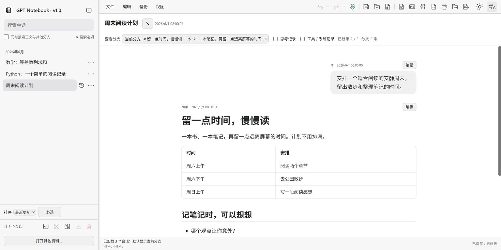
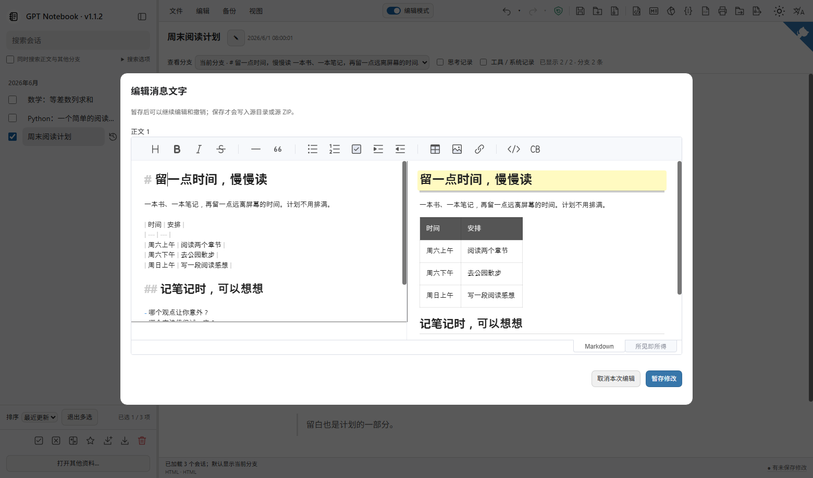
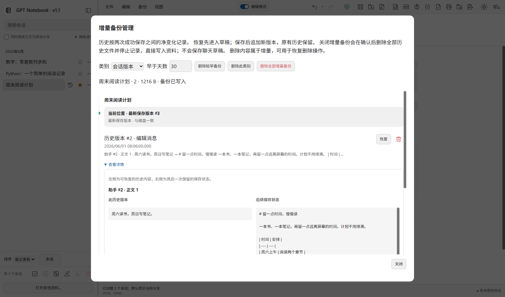
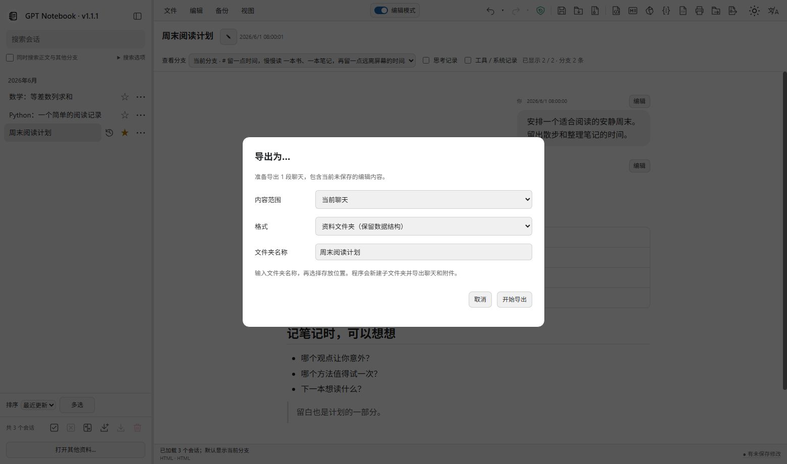

<div align="center">


# GPT Notebook

**用一个 HTML，在本地阅读、编辑和导出 ChatGPT 聊天记录。**

[](./LICENSE)
[](https://github.com/chchaoo/gpt-notebook/releases/latest)
[](https://github.com/chchaoo/gpt-notebook/releases/latest)

**[下载 HTML](https://github.com/chchaoo/gpt-notebook/releases/latest)** · **[在线试用](https://chchaoo.github.io/gpt-notebook/)** · **[English](README.md)**

[使用手册](https://github.com/chchaoo/gpt-notebook/wiki/中文手册) · [从源码构建](https://github.com/chchaoo/gpt-notebook/wiki/从源码构建)

</div>

<div align="center">



*真实运行界面。图中全部聊天均为[虚构样例](examples/zh-CN/sample-archive.zip)。*

</div>

## 为什么用 GPT Notebook？

- **阅读与查找** — 聊天分支、全文搜索、Markdown、代码、公式及本地媒体
- **编辑** — 修改标题和消息，支持 Markdown、可视化编辑及撤销／重做
- **保存与回顾** — 保存／另存为、增量历史、变更摘要及版本对照
- **导出** — HTML、Markdown、JSON、PDF／打印、资料文件夹或 ZIP；支持当前、所选及全部聊天
- **个性化** — 十一种界面语言、主题、字体设置及阅读位置记忆

## 界面一览

### 编辑时对照预览

<div align="center">



</div>

先暂存编辑，确定后再保存。[阅读与编辑说明](https://github.com/chchaoo/gpt-notebook/wiki/阅读编辑与导出)。

### 恢复前查看历史差异

<div align="center">



</div>

先查看变化，再将所需版本恢复为草稿。[保存与历史说明](https://github.com/chchaoo/gpt-notebook/wiki/保存与历史)。

<details>
<summary>查看导出选项</summary>

<div align="center">



</div>

选择范围及格式，导出可包含当前草稿。[导出说明](https://github.com/chchaoo/gpt-notebook/wiki/阅读编辑与导出#导出需要的内容)。

</details>

## 开始使用

1. 下载 **gpt-notebook.html**，用较新的桌面 Chrome 或 Edge 打开。
2. 打开 ChatGPT 导出的文件夹或 ZIP，保留 JSON 与附件的相对位置。
3. 选择聊天，开始阅读、编辑草稿、保存或导出。

无需安装、服务器、账号或 API 密钥。可以先下载[样例 ZIP](examples/zh-CN/sample-archive.zip)体验。[详细步骤](https://github.com/chchaoo/gpt-notebook/wiki/开始使用)。

## 构建

Python 3.12+ 配合仓库保留的运行资产即可构建空白 HTML：

```sh
python tools/project.py verify
python tools/project.py build
```

运行测试还需 Node.js 24 和 pnpm 11.25.0。[完整构建方法及源码目录说明](https://github.com/chchaoo/gpt-notebook/wiki/从源码构建)。

## 隐私与范围

资料在本地处理，应用不上传聊天，也不生成 AI 新回答。包含聊天的导出文件仍是私人资料；主动点击外部来源会访问对应网站。浏览器支持时，保存会修改当前资料，初次使用建议打开副本。[常见问题](https://github.com/chchaoo/gpt-notebook/wiki/常见问题)。

## 许可证

采用 [MIT](LICENSE)。沿用代码及运行组件的版权声明保留在[来源说明](https://github.com/chchaoo/gpt-notebook/wiki/来源说明)与[第三方说明](https://github.com/chchaoo/gpt-notebook/wiki/第三方组件说明)中。本项目与 OpenAI 无隶属关系。
